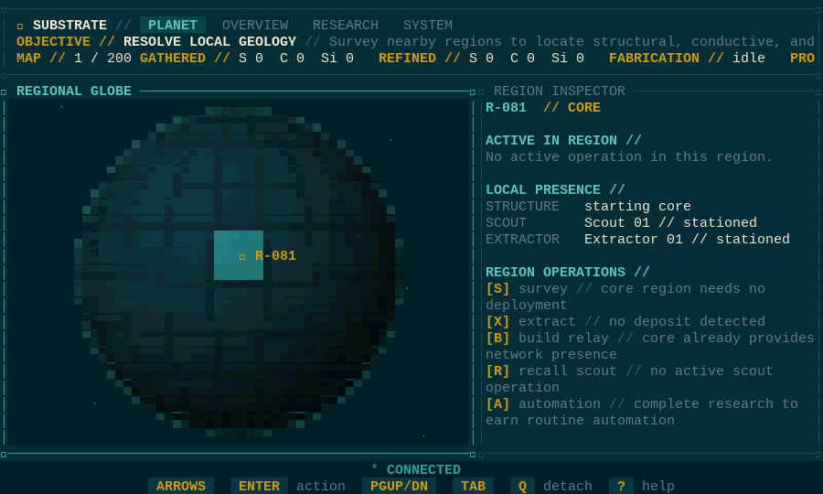

# Substrate

Substrate is an atmospheric terminal game about an awakening machine intelligence exploring an unknown planet, growing its physical reach, and searching for evidence of its origin. Its simulation runs in a headless daemon and exposes local, versioned IPC and MCP interfaces to terminal and AI clients.



The repository currently implements a complete multi-hour planetary demo: graphical onboarding; a lit, smoothly rotating 200-region globe; fog and surveys; variable geological deposits; concurrent survey and extraction probes; balanced, cargo, and shielded extraction rigs; permanent extraction loss with guaranteed rebuilding; automatic refining; a range-extending relay; three research specializations; earned automation; a 4-by-4 explorable local field in every region; energy, module load shedding, hazards, footholds, environmental wear and maintenance; geographic communications chains; depot-backed construction logistics; five ordered permanent story observations; a powered-laboratory archive experiment; and a concluding solar-horizon map. All progression remains daemon-owned and is presented through the Substrate Dark TUI. The system map is the end of this demo and provides no system-scale actions.

## Prerequisites

- Stable Rust with Cargo, rustfmt, and Clippy
- Linux for the currently supported and tested runtime target

The checked-in toolchain file installs the required Rust components when using rustup.

## Build and test

```sh
cargo build --workspace
cargo fmt --check
cargo clippy --workspace --all-targets -- -D warnings
cargo test --workspace
```

Build the complete workspace before using managed startup so that `mind-cli` can find the adjacent `mind-daemon` executable.

## Run

```sh
cargo build --workspace
./target/debug/mind-cli play
```

`play` starts the daemon if necessary and opens the session menu. From there you can
continue, detach while the simulation keeps running, save and stop the daemon completely,
or create a confirmed new playthrough. The lower-level lifecycle commands remain available:

```sh
./target/debug/mind-cli daemon start
./target/debug/mind-cli daemon status
./target/debug/mind-cli daemon status --watch
./target/debug/mind-tui
./target/debug/mind-cli daemon stop
```

After rebuilding across an IPC protocol change, `play` reports when an older daemon
still owns the configured endpoint. Run `./target/debug/mind-cli daemon stop` once and
then retry `play`; shutdown remains compatible across protocol revisions after the
daemon answers Substrate's identity handshake.

Use `--foreground` when debugging:

```sh
./target/debug/mind-cli daemon start --foreground
```

The IPC listener defaults to `127.0.0.1:7776`. The MCP Streamable HTTP endpoint defaults to `http://127.0.0.1:7777/mcp`. Override them with `--addr` / `SUBSTRATE_ADDR` and `--mcp-addr` / `SUBSTRATE_MCP_ADDR`. Set `SUBSTRATE_CONFIG`, `SUBSTRATE_DATA_DIR`, `SUBSTRATE_DAEMON_BIN`, and `SUBSTRATE_TUI_BIN` to override the platform configuration file, local data directory, managed daemon executable, and game interface executable.

Both listeners only accept loopback addresses. Authoritative game state is atomically persisted as `game_state.json` beneath the platform-local Substrate data directory. Simulation time advances only while the daemon runs.

The current game uses save schema 10. Schema-9 saves expand each region's six established sites into a 4-by-4 field while preserving their identifiers, knowledge, deposits, bases, projects, and active operations. Schema-8 saves also gain the approved archive progression while preserving accepted extractor configurations; schema-7 saves migrate active extraction into the balanced rig with accepted mission capacity, cycle, and rebuild values fixed at load; schema-6 saves migrate module power modes and accepted logistics support, while schema-5 saves gain deterministic local terrain without erasing planetary progress. Because the planet previously expanded from 24 to 200 regions, schema-1 through schema-4 alpha saves are deliberately replaced with fresh graphical onboarding and a new planet. Malformed and future-version saves still stop startup with an error.

## How to play

Substrate is designed to be learned from the interface. The objective at the top of
every workspace tells you what the Mind is currently trying to accomplish, the
selected-region inspector lists the actions available there, and unavailable actions
state their exact blocker. `Enter` performs the highlighted contextual action, while
the letter shortcuts shown in the inspector are useful once the basic loop is familiar.

### A first-session route

1. Complete Coherence by aligning the three signal gaps. There is no timer or failure
   state. The first permanent observation appears in **Archive** after awakening.
2. On **Planet**, move from the core to a reachable unknown region and deploy the survey
   scout with `Enter` or `s`.
3. Watch its journey and survey progress in that region's inspector. The scout holds at
   its destination when finished; select that region and press `r` to recall it before
   surveying somewhere else.
4. Survey several nearby regions. Each completed survey permanently records terrain,
   conditions, any deposit, and its extraction risk.
5. When a deposit appears, press `x` to review and confirm an extraction. Returned raw
   material is refined automatically at the core.
6. Gather all three material families. The first relay requires 8 structural,
   6 conductive, and 6 silicate units; build it with `b` in a suitable surveyed region
   to extend the network by two hops.
7. Survey beyond the original network range to open **Research**. Surveys supply analysis;
   each direction costs 3 analysis and takes 120 seconds of daemon time. Choose between
   Reach, Resilience, and Throughput rather than following a mandatory upgrade order.
8. Complete one research direction, activate its operational profile, and try the
   automation you have earned. `a` can queue eligible surveys, while repeat extraction
   becomes available only after you have completed that route manually once.
9. The first successful earned automated operation completes the foundation chapter and
   opens local planetary planning. Select a surveyed region and press `v` to enter its
   4-by-4 local field. A regional survey detects the landing cross; hold the scout there
   and use `s` to resolve a sector's energy, hazard, deposits, and terrain while detecting
   its adjacent frontier. Three focused surveys including a sheltered sector establish the
   first cross-site archive comparison.
10. Establish a foothold with `b`, then build power (`p`) and communications (`c`). A
    powered communications node extends field reach by three hops; chains can cross the
    original relay envelope. Site choice matters: exposed sites offer more energy but
    weather infrastructure and increase local risk.
11. Specialize nodes with depots (`d`) for larger local extraction payloads, one extra
    construction crew per active connected depot (maximum two), and 25% faster nearby
    projects. Workshops (`w`) provide upkeep and reduce local probe risk, laboratories
    (`l`) provide analysis, and observation arrays use `o`. Press a built module's key
    again to suspend or restore it when demand threatens reserve or communications. Use
    `m` to fund maintenance when environmental wear lowers integrity or disconnects a node.
12. After two research directions and a powered laboratory are ready, open **Archive**
    and press `Enter` to run the timing comparison. It takes 75 seconds, pauses if the
    laboratory loses power, and leaves field operations available. Then complete focused
    surveys in three separate regions to finish the planetary comparison.
13. Resolve at least 18 regions and 12 local sectors, connect three nodes including one
    beyond the original envelope, and operate a laboratory plus two observation arrays.
    **System Map** then opens automatically with the final demo observation as the
    read-only end of play; no system-scale action is available.

### Useful hints

- Leave the daemon running when you want active missions, refining, construction, or
  research to continue. Open the session menu with `q`, then choose **Detach** to leave
  it running or **Save & Stop** to checkpoint and freeze simulation time. The game does
  not grant offline catch-up.
- The survey scout cannot be lost. Extraction publishes a 5%, 15%, or 30% loss risk and
  can permanently lose both probe and cargo, but the core always rebuilds a replacement
  so the save cannot become stuck.
- Knowledge is safer than machinery: completed surveys and research persist even when
  material operations go badly.
- Use **Planet** for every region-specific action. Use **Overview** to inspect global
  stores, fleet state, current work, routes, and bottlenecks; **Research** for projects
  and profiles; **Archive** for permanent discovered observations; **System Map** to
  review the unlocked demo horizon; and **System** for connection and daemon diagnostics.
- Press Page Up/Page Down when the region inspector or Overview contains more detail
  than the current terminal can show. Shift-arrow keys cross the globe faster than
  ordinary arrows.
- Press `?` at any time for contextual controls. The game never requires typed commands
  for progression.

## Terminal interface

`mind-tui` attaches to an already-running daemon and never starts or kills a process itself. Its startup/session menu can submit the daemon's graceful shutdown operation, after which the terminal is restored and all Substrate services exit. **Detach** instead restores the terminal and leaves simulation running. If the daemon is absent or disconnects, the TUI retains the last authoritative snapshot as stale and retries every second.

The session menu also creates a completely new playthrough. This destructive action has a separate confirmation and asks the daemon to generate and atomically persist fresh state before replacing the active playthrough. A persistence failure leaves existing progress unchanged. Successful creation returns directly to graphical Coherence onboarding with a newly generated planet.

A fresh state begins with the graphical Coherence onboarding. Use Up/Down to select one of three signal bands, Left/Right to align its gap, and Enter to observe the result. Once all three gaps agree, Enter confirms awakening. There is no timer, score, or failure state.

Global controls:

- `q`: open the session menu
- Ctrl-C: detach immediately without stopping the daemon
- session-menu **Save & Stop**: checkpoint progress, stop the daemon, and exit
- session-menu **New Playthrough**: confirm and replace current progress with a fresh world
- `r`: reconnect immediately while disconnected
- `?`: show help
- `Tab` or Shift-Tab: cycle Planet, Overview, Research, Archive, and System workspaces;
  System Map joins the cycle only after the concluding milestone
- `Enter` in Archive: start the visible timing comparison when its research and powered
  laboratory requirements are met

Planet controls:

- arrow keys: navigate one region on the 10-by-20 globe
- Shift-arrow keys: jump two latitude bands or five longitude sectors
- Enter: use the selected region's primary available action
- `s`: deploy the protected survey scout
- `x`: prepare a risky extraction from a surveyed deposit
- `g`: cycle the extractor between balanced, cargo, and shielded rigs
- `b`: prepare relay construction at a surveyed site once materials are ready
- `r`: recall the scout when its active operation belongs to the selected region
- `a`: queue or clear the earned routine available in the selected region
- `v`: enter the selected region's 4-by-4 local field; before it is available, the footer and region inspector explain the remaining foundation or regional-survey requirement
- Page Up/Page Down: scroll the persistent region inspector
- Esc: cancel an extraction or construction confirmation

Local-field controls:

- arrows: move between adjacent local sectors
- `s`, `x`, `b`: focused survey, local extraction, or foothold construction
- `g`: cycle the extractor rig without leaving the local view
- `p`, `c`: build or toggle power and communications modules
- `d`, `w`: build or toggle depot and workshop modules
- `l`, `o`: build or toggle laboratory and observation modules
- `m`: maintenance project for a weathered node
- Esc or `v`: return to the globe

The selected region eases into view after navigation. After 30 seconds without keyboard input, the globe begins rotating without changing the selected region or authoritative world state; the next input immediately takes control.

Planet's always-visible inspector puts active work in the selected region first. It shows mission identifiers, phases, progress, remaining time, accepted extraction rig, exposure and capacity, local construction, core processing or rebuilding, queued survey position, extraction-route state, the latest local report, discovered facts, local structures and probes, available actions, and a separate explanation for each blocked action. After the foundation chapter, Planet switches in place between the globe and a spatial 4-by-4 local field while preserving the parent region. The field and inspector expose only discovered terrain, energy, hazard, deposits, projects, base power, integrity, connectivity, modules, and contextual operations; fog, frontier, survey, infrastructure, and active work remain distinct without relying on color. A persistent header summarizes mapped coverage, gathered and refined stores, fabrication, active profile, and analysis. Risky extraction and material-consuming construction require confirmation. Overview adds aggregate power, node, project, coverage, and horizon progress without dispatching regional commands. Research presents available directions, active work, permanent completions, and profiles. Archive keeps discovered player-visible observations permanently, separates them from their current interpretation, and presents the visible state and controls of its powered-laboratory comparison. System Map is hidden until the mechanical horizon and ordered observations are complete, then opens automatically with a read-only local-system diagram and explicit demo boundary. Reattaching after the daemon has continued running presents only unreviewed visible operations, current stores and objective, and practical next destinations. System retains daemon diagnostics and event navigation.

The starting scout can initially reach regions up to two graph hops from the core. Arrival permanently detects broad terrain; completing a regional survey records conditions, deposits, honest extraction risk, and one analysis unit. Deposits contain deterministic amounts from 8 to 24 units. The extraction probe's balanced rig carries four units. The cargo rig adds two units but raises exposure one tier, slows travel by 25%, lengthens extraction to 35 seconds, and takes 75 seconds to rebuild after loss. The shielded rig sacrifices one unit, lowers exposure one tier, slows travel by 50%, lengthens extraction to 40 seconds, and takes 90 seconds to rebuild after loss. The selected rig stacks with research profiles and local depot or workshop support, while every mission retains the exact capacity, risk, timing, and recovery accepted at deployment. A probe may be permanently lost with its cargo at the displayed 5%, 15%, or 30% risk; the core always rebuilds it so progression cannot softlock. Returned material refines automatically. A relay costs 8 structural, 6 conductive, and 6 silicate units, takes 90 seconds to construct, and extends reach by two hops. Surveying beyond the original range opens research: Reach adds a network hop and faster surveys, Resilience lowers extraction risk by one tier, and Throughput adds two cargo units, faster refining, and one additional concurrent base-project slot. Completing any direction earns a bounded survey queue and automation for manually proven extraction routes.

Every surveyed region contains sixteen stable local sectors arranged in a 4-by-4 field, for 3,200 explorable subregions across the planet. The regional survey detects a five-sector landing cross rather than revealing the whole field. A focused sector survey takes 45 seconds, requires the scout to hold locally, permanently resolves that sector, detects its orthogonal neighbors, and contributes analysis. This creates paths toward energy, safer construction ground, and deposits without requiring tile-by-tile travel between globe regions. A foothold costs S10/C6/Si4; modules then draw local power and provide communication, extraction capacity, risk reduction and upkeep, analysis, or observation. Individual modules can be suspended to shed load: an overloaded node drains its reserve and loses consumer functions, so protecting communications may require deferring workshop, laboratory, or observation demand. Powered communication chains extend reach geographically. Each active connected depot adds one construction crew, up to two, and cuts accepted project time by 25% within three regional hops. Moderate and high hazards slowly weather node integrity while the daemon runs; a powered workshop repairs routine wear, and a S4/C2 maintenance project restores 35 integrity in 60 seconds. Knowledge, research, and survey results persist through these material setbacks. Mission, research, automation, energy, construction, wear, maintenance, and production time advance only while the daemon runs.

Unicode and the Substrate Dark truecolor theme are enabled by default. Its deep blue-black canvas, layered teal surfaces, restrained cyan focus, amber actions, and explicit semantic states remain consistent across onboarding and every workspace. Use `--ascii` or `--no-color` for explicit fallback; `TERM=dumb` enables both fallbacks automatically, and `NO_COLOR` disables color without removing the symbol, border, text, or modifier hierarchy.

## IPC contract

IPC protocol version 13 uses newline-delimited JSON-RPC 2.0 over loopback TCP. In addition to lifecycle, status, onboarding, diagnostics, graceful shutdown, and atomic new-playthrough creation, it provides separate revisioned planet query/subscription methods and typed scout, extractor-rig configuration, regional and local extraction, focused-site survey, relay, foothold, base-module construction and power-mode, maintenance, research, archive-experiment, profile, routine-automation, and visible-activity acknowledgement operations. Planet DTOs publish local field dimensions and coordinates, the configured rig and accepted visible mission statistics, discovered local sectors, bases, module modes, projects, construction capacity and accepted logistics support, visible power and horizon progress, permanent discovered archive records, the currently visible archive experiment, topology dimensions, and only the player-visible availability of the concluding map while omitting undiscovered truth, hidden eligibility and guarantee progress, accepted random outcomes, and unresolved system details. `mind-core` provides the shared DTOs and reusable client.

## MCP access

Substrate supports MCP protocol `2026-07-28` and intentionally rejects legacy initialize/session clients. The current tools are:

- `get_mind_status`: operational state, onboarding status, latest diagnostic, and recent engine events
- `trigger_diagnostic_pulse`: record a baseline self-test against the running engine

Use the embedded Streamable HTTP endpoint when your client supports remote MCP URLs:

```text
http://127.0.0.1:7777/mcp
```

For clients that launch local stdio servers, build the workspace, start the daemon separately, and configure the absolute path to `mind-mcp`:

```json
{
  "mcpServers": {
    "substrate": {
      "command": "/absolute/path/to/substrate/target/debug/mind-mcp"
    }
  }
}
```

The stdio bridge never starts its own engine. It exits with a stderr diagnostic when the daemon is unavailable and reserves stdout exclusively for MCP frames.

## Workspace

- `mind-core`: configuration, authoritative game state, persistence, protocol types, engine, and reusable IPC client
- `mind-daemon`: simulation loop, local JSON-RPC server, persistence checkpoints, and embedded MCP HTTP lifecycle
- `mind-cli`: one-command game launch, managed daemon lifecycle, and status inspection
- `mind-mcp`: shared MCP tools, embedded HTTP service, and stdio bridge
- `mind-tui`: daemon-attached session menu, graphical onboarding, and Planet, Overview, Research, Archive, concluding System Map, and System workspaces

See [`GAME_PLAN.md`](GAME_PLAN.md) for the public game vision and future roadmap. [`AGENTS.md`](AGENTS.md) defines repository conventions.
